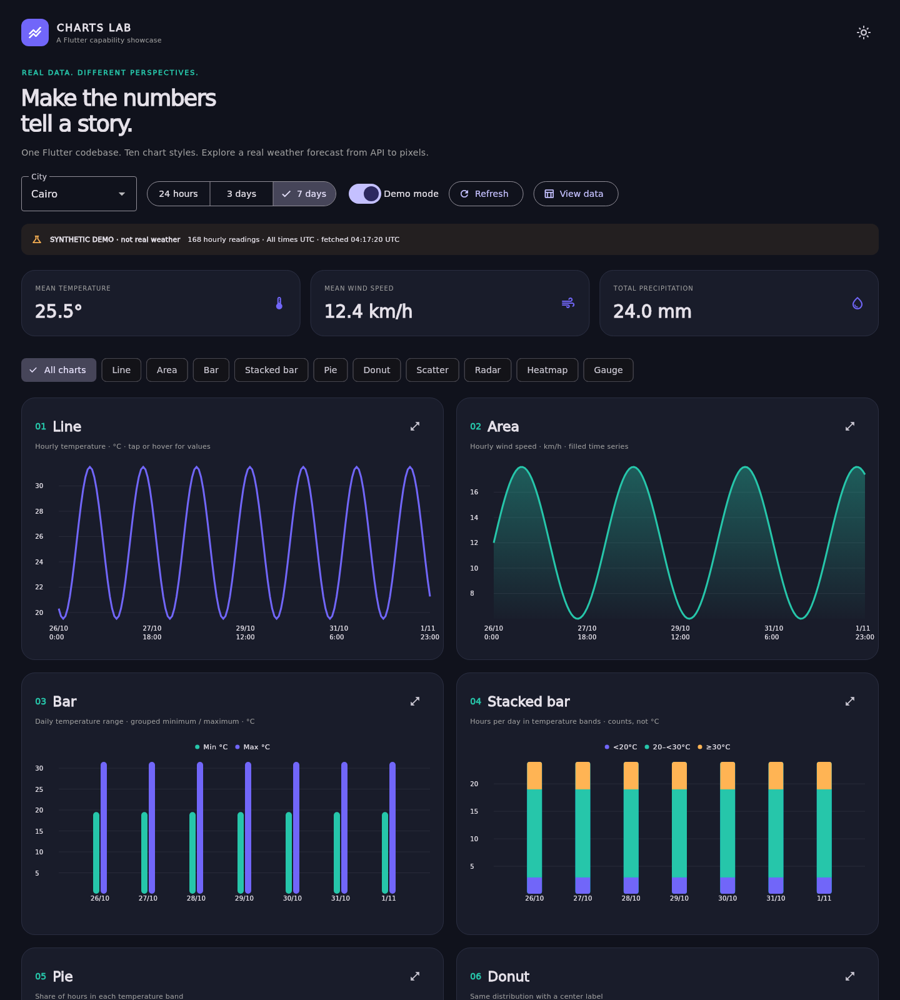

# Flutter Charts Lab

A working Flutter dashboard for demonstrating chart capabilities to stakeholders. Ten chart views consume the same typed weather data. Mobile, tablet and web layouts; dark/light themes; four cities; 24-hour, 3-day and 7-day ranges.



## Run

```sh
flutter pub get
flutter run -d chrome
# Or connect an Android / iOS device:
flutter run
```

Requires Flutter stable with Dart >=3.6. Flutter and package versions resolved by `pubspec.lock` are committed. iOS builds require macOS and signing for physical devices.

## Demonstration flow (3 minutes)

1. Open the app with Demo mode **off**. It requests seven days of hourly model forecast data from Open-Meteo, without an API key.
2. Select Cairo, Alexandria, Riyadh or London. Switch between 24 hours, 3 days and 7 days; every chart and summary changes together.
3. Tap/hover a line point or a bar. Expand a chart. Compare the same temperature distribution as Pie and Donut.
4. Inspect the Scatter plot and Radar. Inspect individual Heatmap cells; scroll it horizontally on phones.
5. Open **View data** to audit the plotted readings, and **Copy CSV** to export them through the clipboard.
6. Change the theme and resize the browser. Try Demo mode for a deterministic offline presentation.

## Chart catalog

| Chart | Data / purpose | Rendering |
|---|---|---|
| Line | Hourly temperature, °C | fl_chart |
| Area | Hourly wind, km/h | fl_chart line with fill |
| Grouped bar | Daily minimum and maximum temperature, °C | fl_chart |
| Stacked bar | Counts of hours per day below 20°C, 20–<30°C, >=30°C | fl_chart |
| Pie | Share of hours in the same three temperature bands | fl_chart |
| Donut | Same distribution, center shows total hours | fl_chart pie |
| Scatter | Hourly temperature vs relative humidity | fl_chart |
| Radar | Mean humidity at 00, 06, 12 and 18 UTC; shared % unit | fl_chart |
| Heatmap | Day × hour temperatures; missing cells stay empty | Flutter widgets |
| Gauge | Mean humidity on a fixed 0–100% scale | Flutter CircularProgressIndicator |

This demonstrates ten visual presentations, not ten distinct library primitives. Radar uses an invisible 100% reference series to keep a stable scale. Heatmap colors use the selected range's minimum/maximum; see its legend. Temperature thresholds are illustrative categories, not meteorological classifications.

## Real data, honestly labeled

- Endpoint: https://api.open-meteo.com/v1/forecast
- `latitude`, `longitude`, `forecast_days=7`, `timezone=UTC`
- Hourly fields: `temperature_2m`, `relative_humidity_2m`, `wind_speed_10m`, `precipitation`
- Explicit units: °C, %, km/h, mm. All timestamps shown in UTC.
- These are numerical **weather forecasts**, not direct sensor observations. Refresh is manual/pull-to-refresh; this is not a live stream.
- Initial loading, empty/malformed data, timeout and HTTP errors are handled. Users explicitly choose synthetic demo data; failed requests never silently fabricate a successful response.
- Missing numeric readings are skipped; mismatched columns and empty responses fail validation. In-flight older city requests cannot overwrite a newer selection.
- The API returns all seven days once. Period changes aggregate/filter locally without extra requests. There is no persistent offline cache.

Data: [Open-Meteo](https://open-meteo.com/) under [CC BY 4.0](https://creativecommons.org/licenses/by/4.0/). Free endpoint is for evaluation/prototyping and non-commercial use; review [provider terms](https://open-meteo.com/en/terms) before commercial use. fl_chart is MIT-licensed. The app displays attribution in its About dialog.

## Adapting to company data

`lib/data/weather.dart` contains HTTP fetching, response validation and aggregation. `lib/ui/charts.dart` consumes typed `Reading` objects; it does not perform networking. `lib/main.dart` owns request state, city selection and presentation.

Replace `WeatherApi.fetch` / its mapping with a company API, then rename chart measures and units. No heavy architecture or state-management framework is required for this showcase. For large datasets, downsample before chart rendering; this demo shows up to 168 hourly points and is not a performance benchmark.

## Verify and build

```sh
dart format --output=none --set-exit-if-changed lib test
flutter analyze
flutter test
flutter build web --release
flutter build apk --debug
```

GitHub Actions runs formatting, analyzer, tests and web/Android builds on main and PRs. Download `android-demo-apk` and `web-preview` from the successful run's artifacts. Debug APK is for demonstration only. Web artifact uses `/flutter-charts-lab/` as its base path; rebuild with your own `--base-href` for a different host.

See [VALIDATION.md](VALIDATION.md) for checks actually performed during implementation and remaining platform limitations.
